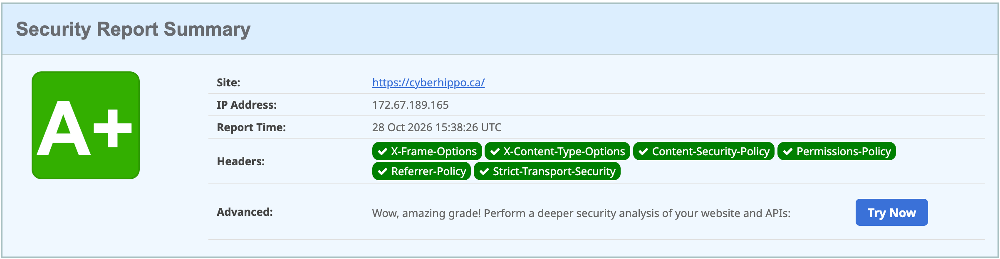

# Hardening a Personal Domain: cyberhippo.ca

*Posted October 28, 2026 · Also on [cyberhippo.ca](https://cyberhippo.ca/writeups/domain-hardening)*

How I locked down my domain and launched a small portfolio site on it: email spoofing protection, DNSSEC, HTTPS enforcement, security headers, HSTS, and an accessibility and quality pass. Everything is on Cloudflare's free plan.

**Result:** spoofed email from the domain is rejected, DNS answers are signed, the site is HTTPS-only, it scores **A+** on securityheaders.com, and **100 in all four Lighthouse categories** on desktop and mobile.



## Starting point

- Domain registered on Cloudflare, with DNS on Cloudflare
- No website, and no email on the domain
- No DNSSEC

A domain that doesn't send email can still be spoofed, and one without a website is still a target for anyone looking to impersonate it. So I treated the "empty" domain as something worth protecting.

## 1. Email spoofing protection

The domain sends and receives no mail, so the goal was to tell every receiving mail server: nothing legitimate ever comes from here, so reject anything that claims to.

| Type | Name | Value | Purpose |
|---|---|---|---|
| TXT | `@` | `v=spf1 -all` | SPF: no server is allowed to send mail for this domain |
| TXT | `*._domainkey` | `v=DKIM1; p=` | DKIM: empty key for every selector, so no DKIM signature can be valid |
| TXT | `_dmarc` | `v=DMARC1; p=reject;` | DMARC: reject mail that fails SPF and DKIM. Subdomains inherit it. |
| MX | `@` | `.` (priority 0) | Null MX (RFC 7505): the domain accepts no mail |

A spoofed message can't pass SPF (no senders allowed) or DKIM (no valid key), so it fails DMARC, and receivers that enforce DMARC reject it.

**Verification:**
```
$ dig TXT cyberhippo.ca +short
"v=spf1 -all"
$ dig TXT _dmarc.cyberhippo.ca +short
"v=DMARC1; p=reject;"
$ dig TXT test._domainkey.cyberhippo.ca +short
"v=DKIM1; p="
$ dig MX cyberhippo.ca +short
0 .
```
The DKIM check queries a made-up selector (`test`) on purpose, to prove the wildcard answers for any selector.

## 2. DNSSEC

DNSSEC signs DNS answers so resolvers can tell a real answer from a forged one. Resolvers follow a chain of trust: the root vouches for `.ca`, `.ca` vouches for my signing key, and my key signs my records.

Setup: **DNS → Settings → DNSSEC → Enable**. Cloudflare signed the zone right away and, since it's also the registrar, sent the DS record to the `.ca` registry automatically. It showed "pending" for a few hours until the registry published it.

**Verification:**
```
$ dig DS cyberhippo.ca +short
2371 13 2 927373CEBBEC928752E3EBA76BCDD4CB96ADB2848E9363C56E9125C1 C205BED6
```
Key tag 2371, algorithm 13 (ECDSA P-256/SHA-256), digest type 2 (SHA-256). Validating resolvers now return answers with the AD ("authenticated data") flag set.

## 3. The site

A single static page: plain HTML and CSS, no JavaScript, no external fonts, scripts or trackers. Code: [cyberhippo-ca/cyberhippo-site](https://github.com/cyberhippo-ca/cyberhippo-site).

Hosted on **Cloudflare Pages**, connected to the GitHub repo, so each push to `main` redeploys. Cloudflare's GitHub access is limited to that one repo.

| Setting | Value |
|---|---|
| Build command | `exit 0` (nothing to build) |
| Output directory | `/` |

## 4. HTTPS, redirects and headers

| Piece | How |
|---|---|
| `cyberhippo.ca` and `www.cyberhippo.ca` | Pages custom domains. Cloudflare creates the DNS records and certificates. |
| `www` → root | Redirect Rule: `https://www.*` → `https://${1}`, 301, query string kept |
| HTTP → HTTPS | **Always Use HTTPS** |
| Security headers | A [`_headers`](https://github.com/cyberhippo-ca/cyberhippo-site/blob/main/_headers) file in the site repo |

The headers:

| Header | Effect |
|---|---|
| `Content-Security-Policy: default-src 'self'; script-src 'none'; ...` | Browsers load only files from this site and run no scripts at all |
| `X-Frame-Options: DENY` | The page can't be embedded elsewhere (clickjacking) |
| `X-Content-Type-Options: nosniff` | No guessing file types |
| `Referrer-Policy: strict-origin-when-cross-origin` | Limits what's shared when visitors follow links away |
| `Permissions-Policy` | Camera, microphone and location turned off |
| `Cross-Origin-Opener-Policy: same-origin` | Other sites can't keep a handle on this page's window |
| `Cross-Origin-Resource-Policy: same-origin` | Other sites can't embed this site's files |
| `require-trusted-types-for 'script'` (in the CSP) | Blocks a class of script-injection attacks |
| `! Access-Control-Allow-Origin` | Removes the `*` CORS header Cloudflare Pages adds by default |

## 5. HSTS

HSTS tells browsers to only ever use HTTPS for the domain, and they cache that instruction. Because it's sticky, I started cautiously:

| Setting | Value | Why |
|---|---|---|
| Max age | 1 month | A mistake fixes itself within a month. I'll raise it once it's proven stable. |
| Include subdomains | Off | I plan internal subdomains that don't have certificates yet |
| Preload | Off | Hard to undo; not until everything is long-term stable |

## 6. Accessibility and site quality

The site was tested with an automated accessibility scan (axe, against WCAG 2.2 AA) and with Lighthouse, and I fixed what they found.

| Finding | Cause | Fix |
|---|---|---|
| Link not distinguishable from text | The inline link was cyan in lavender text, with no underline (1.5:1 between the two colours), so it relied on colour alone | Underline links inside page content |
| Console error and "third-party" script | Cloudflare Web Analytics was injecting a tracking script. My CSP (`script-src 'none'`) blocked it, which logged an error. | Turned Web Analytics off, so nothing is injected |
| `robots.txt` invalid | There was no `robots.txt`, and Pages served the homepage for any unknown path, so crawlers got HTML | Added `robots.txt`, `sitemap.xml` and a `404.html`. With a 404 page, Pages returns real 404s for missing paths. |

Colour contrast was also calculated directly, since automated tools can't measure text over gradients. Every text colour passes WCAG AA (4.5:1) against every background on the page; body text is 14:1 or better.

**Lighthouse (Oct 28, 2026):**

| | Performance | Accessibility | Best Practices | SEO |
|---|---|---|---|---|
| Desktop | 100 | 100 | 100 | 100 |
| Mobile | 100 | 100 | 100 | 100 |

Largest Contentful Paint was 0.4 s on desktop and 1.0 s on emulated mobile (slow 4G).

## Verification summary

| Check | Result |
|---|---|
| `http://cyberhippo.ca` | 301 → `https://cyberhippo.ca/` |
| `https://www.cyberhippo.ca/some/page?x=1` | 301 → `https://cyberhippo.ca/some/page?x=1` |
| HSTS header | `strict-transport-security: max-age=2592000` |
| securityheaders.com | A+ |
| Lighthouse, desktop and mobile | 100 in all four categories |
| `https://cyberhippo.ca/does-not-exist` | 404 |
| WHOIS | No personal information |

## What I learned

- **Verify, don't assume.** After adding the email records, a lookup showed the DKIM wildcard wasn't actually published. Spoofed mail would still have failed DMARC through SPF alone, but the setup didn't match what I'd documented. Checking each record caught it.
- **Redirect rules need traffic to act on.** The `www` redirect did nothing until `www` had a **proxied** DNS record. Cloudflare's rules run at its edge, so requests have to pass through Cloudflare first. The dashboard warned about this, which helped.
- **Dashboards move.** Cloudflare now defaults new projects to Workers. Pages was behind a small "Continue to Pages" link. Knowing what I needed (static hosting from a Git repo) mattered more than knowing where the button used to be.
- **Security controls can catch your own platform.** The CSP blocked an analytics script Cloudflare injected without me adding it. The policy did its job; the fix was turning the feature off rather than loosening the policy.
- **Missing pages should return 404.** Without a 404 page, every unknown path returned the homepage with a 200. That broke `robots.txt` and would make the site look larger than it is to anyone scanning it.
- **Colour isn't enough on its own.** A link that's only a different colour can be invisible to colour-blind visitors. An automated scan caught it in seconds.
- **Sticky settings start small.** HSTS and preload are easy to turn on and slow to undo, so I chose the reversible settings first.

## Next steps

- Raise HSTS max age to 6–12 months after a stable month. It's the only remaining Lighthouse note.
- Manual accessibility checks Lighthouse lists but can't automate, such as a full keyboard and screen reader pass

## References

- RFC 7208 (SPF), RFC 6376 (DKIM), RFC 7489 (DMARC), RFC 7505 (Null MX)
- RFC 4033 (DNSSEC)
- RFC 6797 (HSTS)
- [WCAG 2.2](https://www.w3.org/TR/WCAG22/)
- [Cloudflare Pages: deploy a static site](https://developers.cloudflare.com/pages/framework-guides/deploy-anything)

---

[All write-ups](README.md) · [cyberhippo.ca](https://cyberhippo.ca)
