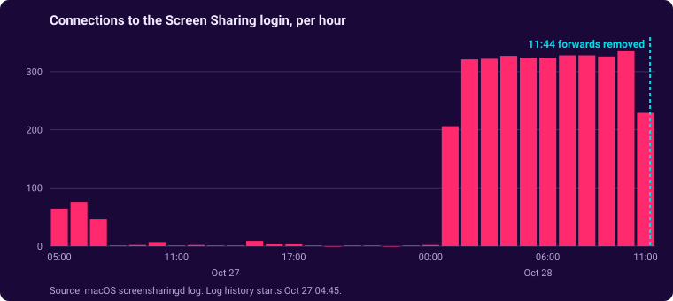

# Closing Exposed Remote Desktop with WireGuard

*Posted October 28, 2026 · Also on [cyberhippo.ca](https://cyberhippo.ca/writeups/remote-access)*

I audited my own OPNsense firewall and found two old port forwards sending internet traffic to a Mac mini on my home network: VNC (Screen Sharing) and RDP. I replaced them with a WireGuard VPN, removed the forwards, checked the logs to see whether anyone got in, and then looked for every other way in from the internet.

**Result:** no successful logins from the internet. Bots had been trying for at least 30 hours. Remote desktop now only works over WireGuard, both ports are closed from outside, and the one app I publish to the internet sits behind an email login.

## Starting point

- OPNsense on a Protectli box, with a config carried over from my previous house
- A Mac mini I connect to remotely for Screen Sharing and file sharing
- Port forwards I had set up years earlier and hadn't looked at since

## 1. The audit

I exported the firewall config and ran it through a small script that prints only the structure (interfaces, rules, NAT, VPN, DNS) and redacts hostnames, password hashes, keys, MAC addresses and public IPs. That made it safe to review and share.

The NAT section showed two forwards from the WAN to the Mac mini:

| Port     | Service                    | Risk                                                           |
|----------|----------------------------|----------------------------------------------------------------|
| TCP 5900 | VNC / macOS Screen Sharing | The Mac's login screen was reachable by anyone on the internet |
| TCP 3389 | RDP                        | Same idea, for Windows Remote Desktop                          |

## 2. WireGuard first, then remove the forwards

I still needed remote access, so I set up the replacement before removing anything. That way I couldn't lock myself out.

| Piece         | Setup                                                                          |
|---------------|--------------------------------------------------------------------------------|
| Instance      | WireGuard on OPNsense, its own interface and a separate subnet for VPN clients |
| Peers         | One per device, each with its own key pair and a single `/32` address          |
| Client config | Split tunnel: only home subnets go through the VPN                             |
| WAN rule      | Allow UDP to the WireGuard port only                                           |
| VPN rule      | VPN clients can reach the LAN, nothing else                                    |

Getting the tunnel working took a few fixes:

| Symptom                       | Cause                                                                | Fix                                                               |
|-------------------------------|----------------------------------------------------------------------|-------------------------------------------------------------------|
| No handshake                  | Two peers had the same tunnel address                                | One peer per device, unique address each                          |
| No handshake                  | The laptop's config used an address and key the firewall didn't know | Added the laptop's public key to its peer and matched the address |
| No traffic reaching WireGuard | The WAN rule had the port on the source side                         | Moved the port to the destination                                 |
| Tunnel up, LAN unreachable    | The allow rule was on the WAN interface                              | Re-created it on the WireGuard interface, destination LAN net     |

Once Screen Sharing worked over the VPN from a phone hotspot, I deleted both forwards (**Firewall → NAT → Destination NAT**).

## 3. Did anyone get in?

macOS logs Screen Sharing authentication, so I pulled the history on the Mac mini:

```bash
log show --predicate 'process == "screensharingd"' --last 7d | grep -i auth
```

Even though I asked for 7 days, macOS only had about 31 hours of history. In that window:

- **Successful logins:** 11, all my own account, all from my home network or my laptop over WireGuard
- **Failed logins from the internet:** 34, from three addresses. Most tried the username `root`, which points to automated bots rather than someone after me specifically.
- **Connections that reached the login step:** about 3,600. Overnight it was a steady 320 or so per hour.



| Source (last octet masked)    | Attempts       |
|-------------------------------|----------------|
| `187.14.82.x` (two addresses) | 26, as `root`  |
| `77.239.124.x`                | 8, no username |

The connections stop at **11:44**, the minute I deleted the forwards.

The RDP forward turned out to point at nothing. macOS has no built-in RDP server (the Remote Desktop app on a Mac is only a client), and nothing was listening on 3389.

## 4. Verify from outside

I checked both ports with an external port checker. Both timed out.

One catch: the check has to run against the **home** IP. My tunnel is split, so browsing from a hotspot with the VPN on would have tested the hotspot's IP instead. I confirmed the IP the checker used matched the firewall's WAN address.

## 5. Other ways in

A port scan only finds things listening for inbound connections. Some tools connect *out* to a vendor and let traffic back in that way, so closing ports doesn't touch them. I went through each one:

| Path                    | Finding                                                                                          | Action                                                             |
|-------------------------|--------------------------------------------------------------------------------------------------|--------------------------------------------------------------------|
| Remote access apps      | AnyDesk installed as a startup service. Its log showed one incoming session, from my own laptop. | Reviewed; to be removed now that WireGuard covers it               |
| Cloudflare Tunnel       | One public hostname, pointing at a single app on the Mac mini                                    | Put Cloudflare Access in front of it (below)                       |
| Remaining port forwards | One, for a media server with its own account login                                               | Kept                                                               |
| macOS sharing settings  | Remote Management on, which controls Screen Sharing                                              | Turned off the separate VNC password; access limited to my account |

## 6. Cloudflare Access for the published app

The tunnel hides my home IP and exposes only one app, but that app's login page was still public. I wanted friends to be able to use it without a VPN, so I added a Cloudflare Access application on the free Zero Trust plan:

| Setting                | Value                                            |
|------------------------|--------------------------------------------------|
| Policy                 | Allow, only listed email addresses               |
| Login method           | One-time PIN by email                            |
| Instant authentication | On, so there's no "choose a login method" screen |
| Session                | 1 month                                          |

The first test sent me to the Cloudflare dashboard login instead of an email-code page. The account already had a "Cloudflare" identity provider, and one-time PIN is only the default when no provider exists. Adding one-time PIN and selecting only it fixed that. Now visitors enter their email, get a code, and only then reach the app.

## What I learned

- **Old forwards outlive their reasons.** These survived a house move without anyone looking at them again.
- **An open port gets found fast.** The log showed steady scanning, not a one-off.
- **Build the replacement first.** Getting WireGuard working before removing the forwards meant no lockout.
- **Closing ports isn't the whole picture.** AnyDesk and Cloudflare Tunnel both connect outward and never show up in a port scan. They needed their own review.
- **Check the logs after the fix.** They answered whether anyone got in, and they showed the exact minute the attack traffic stopped.
- **Test from the right place.** A split tunnel changes which IP an online port checker sees.

## Next steps

- Remove AnyDesk
- Migrate the firewall's leftover legacy rules to the new rules format
- Firewall rules between VLANs, and intrusion detection on the WAN

## References

- [OPNsense: WireGuard road warrior setup](https://docs.opnsense.org/manual/how-tos/wireguard-client.html)
- [WireGuard](https://www.wireguard.com/)
- [Cloudflare Access: self-hosted applications](https://developers.cloudflare.com/cloudflare-one/access-controls/applications/http-apps/self-hosted-public-app/)
- [Cloudflare Access: one-time PIN](https://developers.cloudflare.com/cloudflare-one/integrations/identity-providers/one-time-pin/)

---

[All write-ups](README.md) · [cyberhippo.ca](https://cyberhippo.ca)
